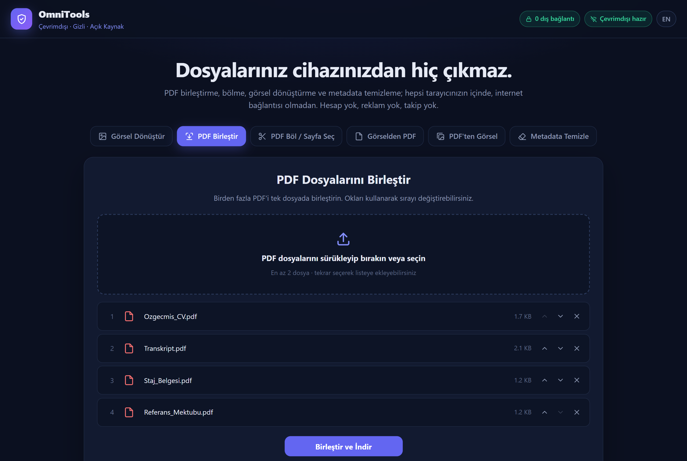

<div align="center">


# OmniTools

**Private, offline, open-source PDF & image tools that run 100% in your browser.**

Your files never leave your device: not because we promise, but because the page *cannot* open a network connection.

[**▶ Live demo**](https://omergns0.github.io/omnitools/) · [Türkçe](#türkçe) · [Report a bug](https://github.com/omergns0/omnitools/issues)




</div>

## Features

| Tool | What it does |
| --- | --- |
| **Convert images** | Batch PNG ⇄ JPG ⇄ WebP (also reads BMP, GIF, AVIF), quality slider, optional resize. **Strips all EXIF data, including GPS location.** |
| **Merge PDFs** | Combine any number of PDFs and reorder them with up/down controls. |
| **Split / extract pages** | Page ranges like `1-3, 5, 8-`, output as one PDF or one PDF per page (ZIP). |
| **Images to PDF** | A4 (auto portrait/landscape) or fit-to-image, margins, respects phone photo orientation. |
| **PDF to images** | Render pages at 72/144/288 DPI as PNG or JPG; download individually or as ZIP. |
| **PDF metadata cleaner** | Shows and removes author, creator app, producer, dates, XMP block and the document ID fingerprint. |

Plus: drag & drop everywhere, Turkish and English UI, installable as an app (PWA), keyboard accessible, mobile friendly.

## Why another PDF tool?

Most "free online PDF tools" upload your documents to a server. Even the privacy-friendly ones usually ask you to *trust* them. OmniTools is built so you don't have to.

| | OmniTools | iLovePDF / Smallpdf | Stirling-PDF | BentoPDF |
| --- | :---: | :---: | :---: | :---: |
| Files stay on your device | ✅ | ❌ uploaded | ⚠️ sent to your own server | ✅ |
| Network access blocked by CSP (`connect-src 'none'`) | ✅ | ❌ | ❌ | ❌ |
| Analytics / trackers | none | yes | opt-out | anonymous analytics on hosted site |
| Works from a USB stick (`file://`), no server at all | ✅ | ❌ | ❌ needs a server | ❌ needs a web server |
| Install / build needed | none, open `index.html` | n/a | Docker + Java | Node build / Docker |
| Size of own code | ~100 KB, readable in an afternoon | closed | large | large |
| Number of tools | 6 focused tools | many | 50+ | 100+ |
| License | MIT | proprietary | MIT (open-core) | AGPL-3.0 |

OmniTools deliberately does fewer things, so the whole codebase stays small enough for anyone to audit.

## How the privacy guarantee works

1. **No server-side code.** It's a static folder of HTML, CSS and JavaScript.
2. **No third-party requests.** Every library (pdf-lib, pdf.js) is vendored in [`vendor/`](vendor) and pinned to an exact version with SHA-512 checksums ([`vendor/SHA512SUMS`](vendor/SHA512SUMS)). No CDNs, web fonts, icon fonts or analytics.
3. **The browser enforces it.** [`index.html`](index.html) ships this Content-Security-Policy:
   ```
   default-src 'none'; script-src 'self'; connect-src 'none'; form-action 'none'; ...
   ```
   `connect-src 'none'` forbids `fetch`, `XMLHttpRequest`, WebSocket and beacons. Even if a bug, a dependency or a malicious PDF tried to send data out, the browser would refuse.
4. **You can watch it.** The badge in the header counts every resource loaded from outside the app's own folder. It should always read **0**. Open DevTools → Network to double-check.
5. **CI keeps it that way.** [`.github/workflows/integrity.yml`](.github/workflows/integrity.yml) verifies the vendored library checksums and fails if any external URL sneaks into the code.

## Using it

- **Online:** open the [live demo](https://omergns0.github.io/omnitools/). After the first visit it is cached by a service worker and works with Wi-Fi turned off. Use the browser's *Install* button to add it as an app.
- **Fully offline:** [download the ZIP](https://github.com/omergns0/omnitools/archive/refs/heads/main.zip), extract it anywhere (even a USB stick) and double-click `index.html`.
- **Self-host:** serve the folder with any static web server, e.g. `python -m http.server`.

## Development

There is no build step and no `npm install`.

```bash
git clone https://github.com/omergns0/omnitools.git
cd omnitools
python -m http.server 8000   # then open http://localhost:8000
```

```
index.html            page structure + CSP
css/style.css         hand-written styles (no framework)
js/app.js             all tool logic
js/i18n.js            Turkish / English strings
js/zip.js             tiny dependency-free ZIP writer
sw.js                 offline cache (service worker)
vendor/               pdf-lib 1.17.1, pdf.js 3.11.174 + checksums
```

When you change any file that the app loads, bump `CACHE` in `sw.js` so installed copies update. See [CONTRIBUTING.md](CONTRIBUTING.md).

## Limitations

- Password-protected PDFs are not supported (they are detected and reported).
- Very large files are limited by your device's memory, since everything happens in RAM.
- PDFs that rely on non-embedded CJK fonts may render with substitute fonts in *PDF to images* (no font files are downloaded, by design).

## License

[MIT](LICENSE) © Ömer (@omergns0). Third-party licenses: [THIRD_PARTY_NOTICES.md](THIRD_PARTY_NOTICES.md).

---

## Türkçe

**Tamamen tarayıcınızda çalışan; çevrimdışı, gizli ve açık kaynak PDF & görsel araçları.**

Dosyalarınız cihazınızdan hiç çıkmaz. Bunu söz vererek değil, sayfanın ağ bağlantısı açmasını tarayıcı düzeyinde engelleyerek garanti ediyoruz.

### Özellikler

- **Görsel dönüştürme:** PNG ⇄ JPG ⇄ WebP toplu dönüştürme, kalite ve boyut ayarı. Fotoğraflardaki **GPS konumu dahil tüm EXIF bilgileri silinir.**
- **PDF birleştirme:** sınırsız dosya, sıralamayı oklarla değiştirme.
- **PDF bölme / sayfa çıkarma:** `1-3, 5, 8-` gibi aralıklar; tek PDF veya her sayfa ayrı (ZIP).
- **Görselden PDF:** A4 (otomatik yatay/dikey) veya görsel boyutunda sayfa; telefon fotoğraflarının yönü korunur.
- **PDF'ten görsel:** 72/144/288 DPI, PNG veya JPG, tek tek ya da ZIP.
- **PDF metadata temizleyici:** yazar, program, tarih, XMP ve belge kimliği (ID) gibi gizli bilgileri gösterir ve siler.

### Neden güvenli?

- Sunucu yok; tamamen statik dosyalar.
- Hiçbir CDN, font, analitik veya reklam yok. Kütüphaneler `vendor/` klasöründe, SHA-512 ile doğrulanmış.
- `connect-src 'none'` güvenlik politikası sayesinde sayfa **hiçbir ağ isteği gönderemez**.
- Üst çubuktaki sayaç dış bağlantı sayısını canlı gösterir: her zaman **0**.

### Kullanım

- [Canlı demo](https://omergns0.github.io/omnitools/): ilk ziyaretten sonra internet olmadan da çalışır, uygulama olarak yüklenebilir.
- Tamamen çevrimdışı: [ZIP'i indirin](https://github.com/omergns0/omnitools/archive/refs/heads/main.zip), klasörü açın ve `index.html`'e çift tıklayın (USB bellekten bile çalışır).

Katkılarınızı bekliyoruz. [CONTRIBUTING.md](CONTRIBUTING.md) dosyasına göz atın.
